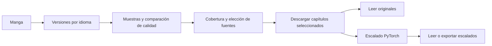
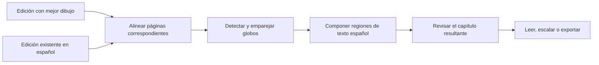
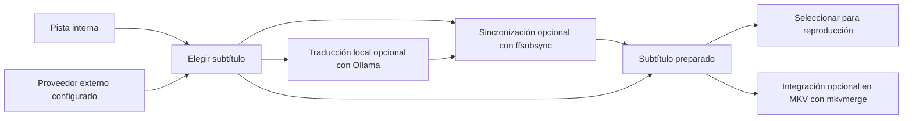

<p align="center"></p>

<p align="center"><a href="README.md">English</a> · <strong>Español</strong></p>

# AniManga Studio

**Un gestor de anime y manga autoalojado, impulsado por mejora de imagen con IA.** Organiza tu colección, descubre estrenos, lee manga y reproduce anime desde una aplicación: shaders Anime4K CNN en tiempo real para anime y modelos locales de superresolución PyTorch para manga.

Los shaders procesan fotogramas sin cambiar el archivo de vídeo. Los modelos de manga generan páginas de mayor resolución para leer y exportar. La mejora no garantiza recuperar detalle real perdido en el original.

[Funciones](#funciones) · [Recorrido visual](#recorrido-visual) · [Android](#android) · [Primeros pasos](#primeros-pasos) · [Integraciones](#integraciones) · [Contenido y licencias](#contenido-y-licencias)


## Funciones

### Manga: elegir edición, mejorar páginas y leer

- **Biblioteca y descubrimiento.** Busca en MangaDex y fuentes disponibles mediante Suwayomi, gestiona descargas e importaciones y conserva el progreso. Los capítulos externos y los archivos importados pueden convivir en una misma obra.
- **Versiones y selección de fuentes.** Consulta ediciones por idioma, lee muestras y compara calidad antes de descargar. Los rankings utilizan muestras: orientan, no garantizan que todas las páginas sean mejores.
- **Cobertura por capítulo.** Consulta qué fuentes tienen cada entrega, filtra por idioma y elige fuentes para completar huecos sin tratar cada edición como una obra independiente.
- **Traducción por trasplante de texto.** Combina arte de mayor calidad con una edición existente en español. El proceso alinea páginas, detecta globos y compone regiones de texto en español sobre el dibujo elegido. **No es traducción automática libre**: requiere ediciones compatibles y una traducción previa. Diferencias de maquetación o dibujo pueden impedir una correspondencia fiable; revisa el resultado antes de usarlo como capítulo principal.
- **Superresolución local PyTorch.** Carga modelos compatibles mediante [spandrel](https://github.com/chaiNNer-org/spandrel). El selector visual distingue blanco y negro y color, muestra pesos no disponibles y exige confirmar el modelo activo. Las comparaciones antes/después aparecen cuando se han preparado muestras locales.
- **Elección de modelo.** El registro contempla MangaJaNai, eula-digimanga, DWTP, APISR, IllustrationJaNai y AnimeSharp. La disponibilidad depende de los pesos instalados. El factor de escala es propio de cada modelo, no una opción universal «4K»; las entradas adaptativas pueden elegir pesos según la altura de página.
- **Modelos compatibles propios.** Obtén pesos de publicaciones originales o [OpenModelDB](https://openmodeldb.info/), colócalos en la carpeta de modelos y regístralos en `models/registry.json`. Compatibilidad y licencias siguen aplicándose. Es un flujo de archivos y registro, **no una subida desde la interfaz**. Consulta [Modelos](docs/MODELS.md).
- **Lector integrado.** Lee originales o escalados, reanuda, navega con teclado o extremos de página, desplázate con rueda y amplía con Ctrl + rueda. Oculta controles para leer sin distracciones.
- **Importación CBZ/CBR.** Importa varios archivos, también arrastrando y soltando, dentro de una obra nueva o existente. Revisa la asignación de capítulos para evitar duplicados por diferencias de título.
- **Constructor de tomos.** Agrupa capítulos originales o escalados, elige portada o página de color y exporta con ComicInfo.xml. Se conserva el formato compatible de portada cuando es posible. Codificación y calidad afectan al tamaño y tiempo. Usa CBZ para interoperabilidad: la opción actual denominada CBR escribe contenido ZIP con extensión .cbr, no un RAR auténtico.
- **Varios trabajos de exportación.** Inicia un tomo y configura otro mientras se procesan los trabajos, con seguimiento de progreso y salida local. Los límites de workers siguen regulando la concurrencia.

### Anime: descubrimiento, descargas y reproducción nativa

- **Descubrimiento y biblioteca.** Búsqueda con AniList, temporada, calendario diario, obras relacionadas y navegación de franquicias. Combina géneros y temáticas y define umbrales de relevancia.
- **Gestión de episodios.** Conserva vistos y «seguir viendo», importa carpetas, corrige numeraciones y gestiona archivos entre discos. El historial es independiente de los archivos descargados.
- **Torrents.** Busca en Nyaa y envía publicaciones a qBittorrent. Los lotes permiten seleccionar archivos antes de descargar: una temporada o episodios sueltos, no toda la colección. qBittorrent es un cliente independiente que debes configurar.
- **Reproductor nativo.** El shell Windows Rust/WebView2 integra **libmpv**. Vídeo y subtítulos usan el renderizado de mpv; el reproductor de navegador es una alternativa distinta.
- **Mejora CNN en tiempo real.** Los presets Anime4K van desde procesamiento ligero hasta restauración multietapa:
  - **Doble restauración:** dos restauraciones CNN, dos escalados CNN UL y refinamiento Thin HQ.
  - **Máxima / triple restauración:** control de altas luces → Restore CNN VL → Upscale CNN x2 UL → pre-reducción automática → Restore CNN VL → Upscale CNN x2 UL → Restore CNN UL → Thin HQ.

  VL y UL identifican variantes de red. «Triple» cuenta restauraciones: **no** significa tres codificaciones completas, calidad garantizada de 3× ni resolución fija. El procesamiento efectivo depende de las condiciones de shaders, resolución y tamaño de reproducción; los presets superiores consumen más GPU.
- **Subtítulos.** Selecciona pistas internas o busca en proveedores configurados, sincroniza con ffsubsync, traduce mediante Ollama local e integra subtítulos con mkvmerge. Disponibilidad, credenciales y compatibilidad condicionan el resultado. La implementación actual no tiene fallback a Gemini.
- **Estudio de idiomas.** Esta rama de desarrollo incluye pistas de estudio inglés/japonés con traducción secundaria, ayuda visible o bajo demanda, tiempos y tamaños independientes y consulta de diccionario japonés. Necesita pistas reales; no es transcripción automática del audio.

### Biblioteca local

Progreso, historial, actividad y almacenamiento forman parte de la aplicación. WebDAV puede exponer contenido local configurado a lectores compatibles. Android es un **proyecto separado**: este checkout no genera su APK.

Autoalojado no significa totalmente offline: descubrimiento, fuentes, torrents y subtítulos externos requieren conexión. La mejora local utiliza tu hardware.

### Cine: espacio propio para series y películas

Gestiona series y películas en una biblioteca separada, con descubrimiento, historial y «seguir viendo». Sonarr, Radarr y Prowlarr integran los flujos de colección y búsqueda configurados, con qBittorrent como cliente de descarga. Se utiliza el reproductor compartido.

## Recorrido visual

### Elegir una edición de manga

Parte de la obra, compara ediciones y elige fuentes por capítulo. Idioma y cobertura acotan la selección; las muestras permiten valorar el dibujo.


*Punto de entrada al descubrimiento de versiones; los resultados aparecen al realizar la búsqueda.*



### Traducción de manga: conservar el dibujo y aprovechar otra traducción

El trasplante utiliza dos ediciones del mismo capítulo. Transfiere una traducción existente en español, en lugar de pedir a un modelo de lenguaje que traduzca todo el manga.


*Prepara la búsqueda de fuentes y, si lo prefieres, conserva tus páginas escaladas como dibujo.*



Las diferencias entre ediciones pueden impedir una alineación fiable. La revisión importa: el diagrama explica el proceso, no garantiza que pueda componer todas las páginas.

### Biblioteca de manga

Continúa leyendo, filtra tu colección y distingue capítulos descargados de archivos locales.


### Tomo Builder

Elige capítulos, portada, codificación y calidad dentro de la ficha. Prepara otro tomo mientras se procesa una exportación.


### Escalado de manga

Compara la página original con el resultado antes de decidir cómo preparar tu edición.


*Previsualizar no activa el modelo. Confirma cuando quieras cambiar el utilizado para escalar.*


*El mismo recorte antes y después de escalar 4×. El resultado depende del original y modelo.*

### Mi Anime

Obras destacadas, continuar viendo y biblioteca con filtros de estado y género.


### Ficha y episodios

Miniaturas, progreso y acciones de reproducción o descarga. El estado de visionado es independiente de los archivos disponibles.


### Reproductor nativo de PC

Reproducción libmpv integrada con posición, audio, subtítulos, Anime4K y episodios. La captura muestra un preset de doble restauración; el máximo actual añade una tercera restauración CNN.


### Calendario de estrenos

Consulta estrenos por día y cambia entre semana y agenda. Los horarios dependen de los metadatos del catálogo.


### Preparar subtítulos

Las pistas internas y los subtítulos externos son orígenes distintos. Utiliza una pista adecuada existente cuando esté disponible; traducción y sincronización son operaciones separadas, no pasos obligatorios para cada episodio.



### Series y películas

Cine mantiene biblioteca y navegación propias, sin mezclar títulos con anime.


## Android

El complemento es otro proyecto Kotlin/Jetpack Compose en la carpeta hermana `animanga-android`; su código y APK no se incluyen aquí.

- Biblioteca y descargas locales mediante MangaDex y extensiones compatibles.
- Lectura offline sin depender del PC para títulos de fuentes del móvil.
- PC como origen adicional, incluida la descarga de capítulos escalados.
- Biblioteca separada de archivos CBZ/CBR.
- Reproducción y descarga de anime del PC y calendario de temporada.

El escalado IA y la traducción pesada permanecen en PC; Android consume sus resultados.

## Primeros pasos

La configuración principal es **Windows con shell Rust/WebView2 + libmpv y backend en WSL2**. Otras rutas tienen requisitos distintos y no equivalen a esta configuración nativa.

1. Consulta [Instalación de escritorio](docs/INSTALL_DESKTOP.md) para preparar o compilar.
2. Configura carpetas e integraciones con `.env.example` como referencia.
3. Instala pesos compatibles: [Guía de modelos](docs/MODELS.md).
4. Configura WebUI de qBittorrent para torrents y Suwayomi para fuentes adicionales.

```bash
git clone https://github.com/RoierOc/animanga-studio.git
cd animanga-studio
```

[Instalación del backend](docs/INSTALL.md) describe dependencias, compilación frontend y herramientas. Tras preparar el entorno, `./start_server.sh` inicia el backend en `http://localhost:5101` por defecto; no compila por sí solo el reproductor Windows.

**Hardware:** escalar manga con PyTorch requiere NVIDIA compatible y CUDA/PyTorch adecuados. Anime4K usa la GPU de reproducción, no el worker de manga. La memoria depende del modelo, página y preset. Gestionar la biblioteca no requiere inferencia.

**Herramientas opcionales:** Suwayomi/Java para fuentes; qBittorrent para torrents; FFmpeg/MKVToolNix para multimedia; Ollama y pesos de modelo de lenguaje para traducción; bsdtar para leer CBR/RAR auténticos. Solo las integraciones que lo requieren necesitan credenciales. No publiques tu `.env`, biblioteca ni secretos.

## Integraciones

AniManga Studio integra estos proyectos y servicios sin atribuirse autoría ni sustituir sus licencias:

| Proyecto/servicio | Función |
|---|---|
| [Anime4K](https://github.com/bloc97/Anime4K) | Shaders CNN de restauración, escalado y refinamiento |
| [mpv / libmpv](https://mpv.io/) | Reproducción nativa de vídeo y subtítulos |
| [PyTorch](https://pytorch.org/) / [spandrel](https://github.com/chaiNNer-org/spandrel) | Inferencia local y carga de arquitecturas compatibles |
| [Suwayomi Server](https://github.com/Suwayomi/Suwayomi-Server) | Servidor opcional de fuentes y extensiones |
| [MangaDex](https://mangadex.org/) / [AniList](https://anilist.co/) | Acceso a fuentes, descubrimiento y metadatos |
| [qBittorrent](https://www.qbittorrent.org/) / [Nyaa](https://nyaa.si/) | Cliente torrent y búsqueda de publicaciones |
| [FFmpeg](https://ffmpeg.org/) / [MKVToolNix](https://mkvtoolnix.download/) | Inspección multimedia y operaciones de contenedor/subtítulos |
| [Ollama](https://ollama.com/) | Inferencia local para traducción |

Suwayomi es un runtime opcional obtenido por separado, **no un catálogo incluido**. Las extensiones acceden a servicios de terceros sujetos a sus condiciones y disponibilidad. Pesos, diccionarios y dependencias descargadas conservan sus licencias.

## Contenido y licencias

AniManga Studio es software, **no distribuye episodios, capítulos de manga ni colecciones de subtítulos**. Clonar el código no incluye una biblioteca personal. El usuario es responsable del contenido importado o descargado: utiliza material propio o autorizado y respeta derechos de autor y términos de los servicios.

Las capturas y muestras ilustrativas pueden mostrar arte de terceros; no conceden derechos sobre las obras representadas. La licencia de la aplicación no cubre arte, contenido multimedia, extensiones, pesos ni dependencias de terceros.

El código propio tiene [licencia MIT](LICENSE). Los componentes de terceros conservan sus licencias y las obligaciones correspondientes al redistribuir compilaciones empaquetadas.
