<p align="center">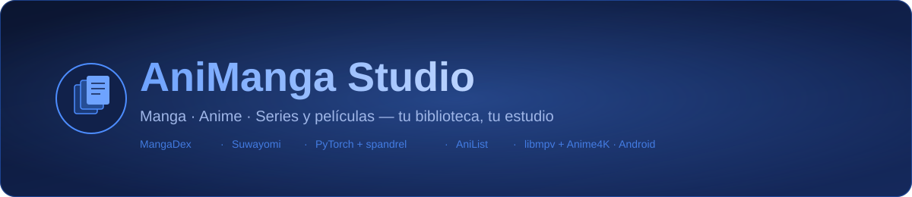</p>

<p align="center"><strong>English</strong> · <a href="README.es.md">Español</a></p>

# AniManga Studio

**A self-hosted anime and manga manager powered by AI image enhancement.** Organize your collection, discover releases, read manga and watch anime in one desktop application: real-time Anime4K CNN shaders for anime, and local PyTorch super-resolution models for manga.

Anime shaders process frames during playback without changing the video file. Manga models generate higher-resolution pages for reading and export. Enhancement does not guarantee recovery of the original artwork's missing detail.

[Features](#features) · [Visual tour](#visual-tour) · [Android](#android) · [Getting started](#getting-started) · [Integrations](#integrations) · [Content and licenses](#content-and-licenses)

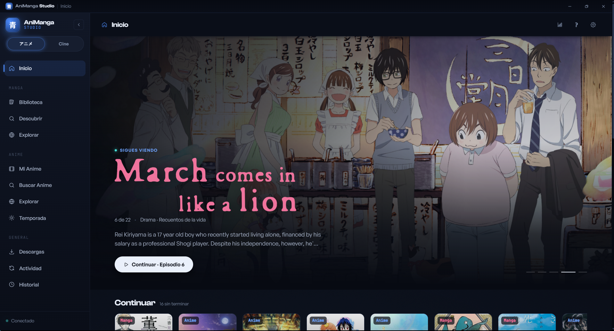

## Features

### Manga: choose the edition, improve the pages, keep reading

- **Library and discovery.** Search MangaDex and sources exposed by Suwayomi, manage downloaded chapters and local imports, and keep reading progress. Source downloads and imported archives can coexist within the same manga.
- **Versions and source selection.** Browse editions by language, read samples and compare source quality before downloading. Rankings use sampled pages and are selection aids, not a guarantee that every page is better.
- **Chapter coverage.** See which sources provide each chapter, filter the coverage grid by language and select sources to fill gaps rather than treating every edition as a separate work.
- **Translation by text transplant.** Combine higher-quality artwork with an existing Spanish edition. The pipeline aligns corresponding pages, detects speech balloons and composites Spanish text regions onto the chosen artwork. This is **not unrestricted machine translation**: it requires compatible editions and a Spanish translation. Different layouts or artwork can prevent reliable matching; inspect the result before using it as your main chapter.
- **Local PyTorch super-resolution.** Load supported models through [spandrel](https://github.com/chaiNNer-org/spandrel). The visual selector separates black-and-white and color use cases, shows unavailable weights and requires explicit confirmation before changing the active model. Before/after comparisons appear when local preview assets have been prepared.
- **Model choice.** The registry covers families such as MangaJaNai, eula-digimanga, DWTP, APISR, IllustrationJaNai and AnimeSharp. Availability depends on installed weights. Scaling factors belong to each model, not a universal “4K” switch; adaptive entries can select weights by input-page height.
- **Bring compatible models.** Get weights from original releases or [OpenModelDB](https://openmodeldb.info/), place them in the models directory and register them in `models/registry.json`. Compatibility and model licenses apply. This is a file-and-registry workflow, **not an in-app upload feature**. See [Models](docs/MODELS.md).
- **Integrated reader.** Read original or enhanced pages, resume reading, navigate by keyboard or page edges, scroll with the wheel and zoom with Ctrl + wheel. Hide controls for distraction-free reading.
- **CBZ/CBR import.** Import multiple archives, including drag and drop, into a new or existing manga. Review chapter assignment to avoid duplicates caused only by different titles.
- **Volume builder.** Assemble chapters from original or enhanced pages, choose a cover or color page, and export comic archives with ComicInfo.xml metadata. Compatible cover formats are preserved when possible. Encoding and quality settings affect size and processing time. Use CBZ for interoperability: the current export option named CBR writes ZIP content with a .cbr extension, not a genuine RAR archive.
- **Multiple exports.** Start one volume and configure another while jobs run, with progress tracking and local output files. Worker limits still govern concurrency.

### Anime: discovery, downloads and native playback

- **Discovery and library.** AniList-backed search, seasonal releases, daily airing calendar, related works and franchise navigation. Explore genres and themes, combine filters and set theme-relevance thresholds.
- **Episode management.** Track watched episodes and continue watching, import local folders, correct episode numbering and manage files across disks. Viewing history is separate from the downloaded files.
- **Torrents.** Search Nyaa and send releases to qBittorrent. Batch releases offer file selection before downloading: choose a season or individual episodes instead of the whole collection. qBittorrent remains a separately configured client.
- **Native player.** The Windows Rust/WebView2 shell embeds **libmpv**. Video and subtitles use mpv rendering; the browser player is a separate path, not the native shader implementation.
- **Real-time CNN enhancement.** Anime4K presets range from lighter processing to multi-stage restoration:
  - **Double restoration:** two CNN restoration stages, two UL CNN upscaling stages and Thin HQ line refinement.
  - **Maximum / triple restoration:** highlight clamp → Restore CNN VL → Upscale CNN x2 UL → automatic pre-downscale stages → Restore CNN VL → Upscale CNN x2 UL → Restore CNN UL → Thin HQ.

  VL and UL identify Anime4K network variants. “Triple” counts restoration stages: it does **not** mean three full video encodes, guaranteed 3× quality or fixed output resolution. Effective processing depends on shader conditions, input resolution and playback size; higher presets consume more GPU time.
- **Subtitles.** Select embedded tracks or search configured external providers, synchronize timing with ffsubsync, translate with local Ollama inference and embed prepared subtitles with mkvmerge. Availability depends on provider access, credentials and compatible tracks. The current translation implementation has no Gemini fallback.
- **Language study.** This development branch also supports English/Japanese study tracks with a secondary translation track, always-visible or on-demand assistance, independent timing and text sizes, and Japanese dictionary lookup. It requires actual subtitle tracks, not automatic speech transcription.

### Local-first collection

Progress, history, activity and storage tools are part of the application. WebDAV can expose configured local content to compatible readers. The Android companion is a **separate project**; this desktop checkout does not build its APK.

Self-hosted does not mean entirely offline: discovery, sources, torrents and external subtitle services need network access. Local enhancement runs on your own hardware.

### Cinema: a separate space for series and films

Manage series and films in their own library, with discovery, history and continue-watching actions. Sonarr, Radarr and Prowlarr integrations handle the configured collection and release workflows, with qBittorrent as the download client. Playback uses the shared player.

## Visual tour

### Choosing a manga edition

Start with the work, compare available editions and choose sources chapter by chapter. Language and coverage filters narrow the selection; page samples help judge the artwork.

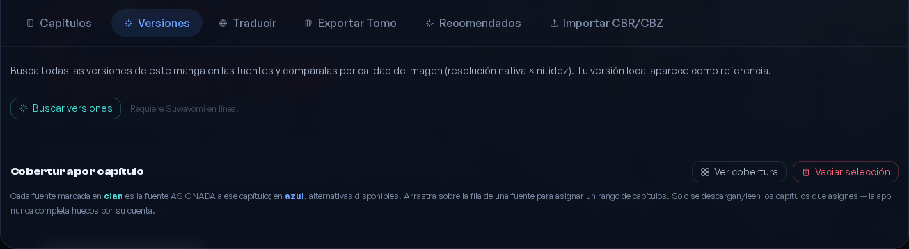

*The entry point for version discovery; source results appear after a search.*

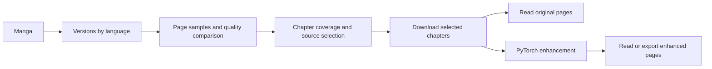

### Manga translation: keep the artwork, use an existing translation

Text transplant uses two editions of the same chapter. It transfers an existing Spanish translation rather than asking a language model to translate the whole manga.

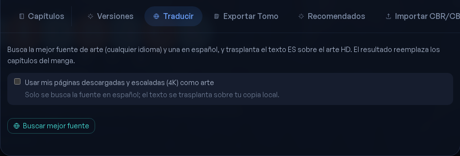

*Prepare source discovery here, optionally keeping local enhanced pages as the artwork.*

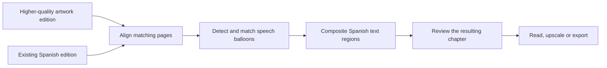

Differences between editions can prevent reliable alignment. Review is important: this diagram describes the processing path, not a guarantee that every page can be composed.

### Manga library

Continue reading, filter your collection and distinguish downloaded chapters from local archives.

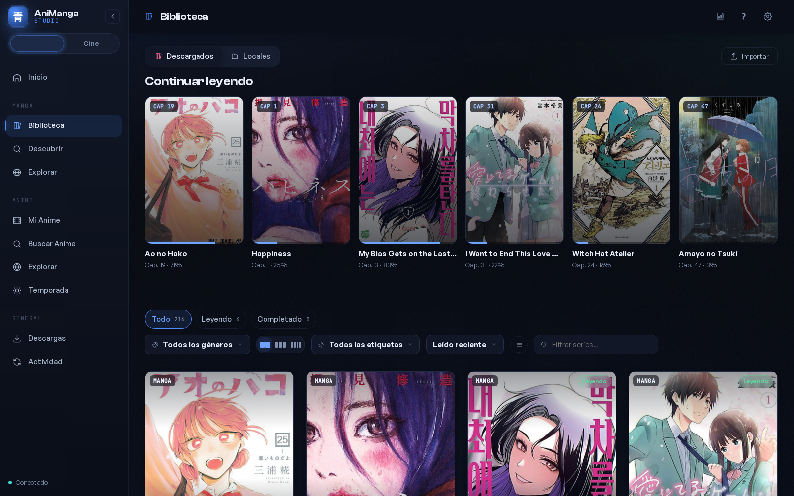

### Volume builder

Choose chapters, cover, encoding and quality within the manga details. Prepare another volume while an export is processing.

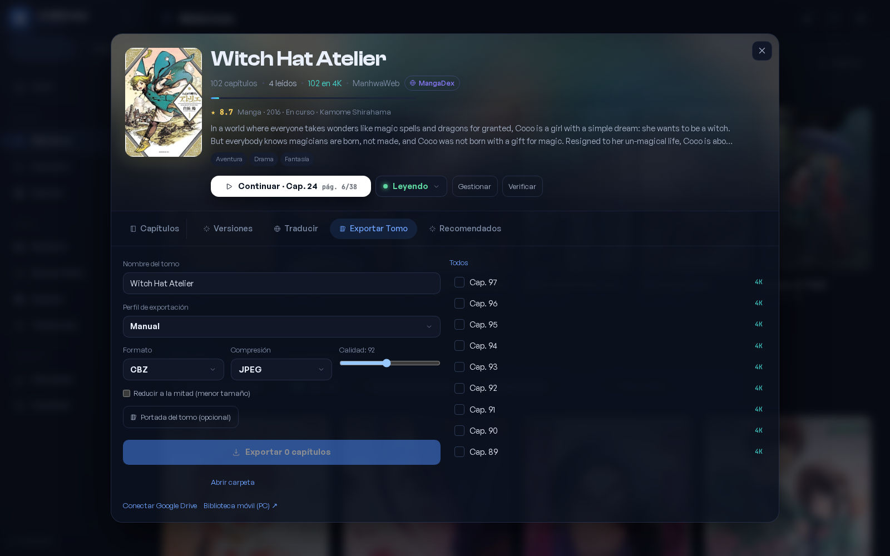

### Manga enhancement

Compare the original page with the enhanced result before deciding how to prepare your edition.

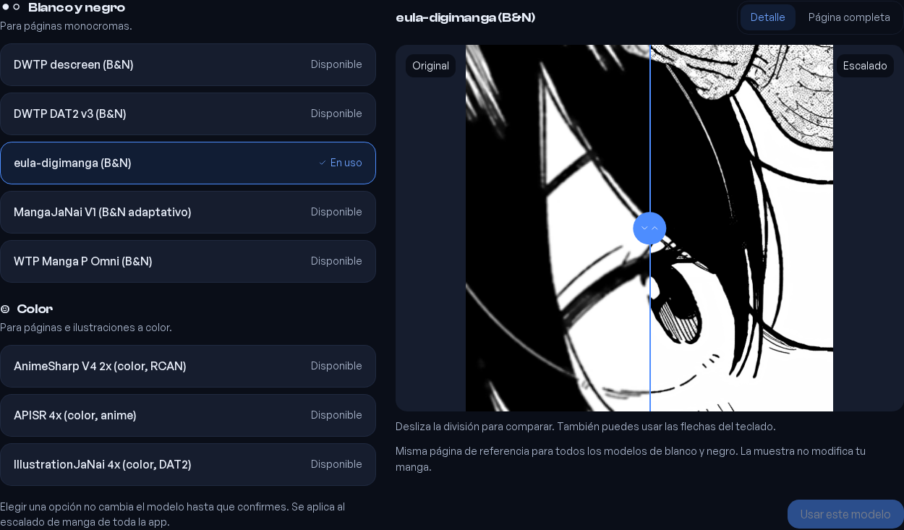

*Previewing a model does not activate it. Confirm explicitly when you want to change the model used for enhancement.*

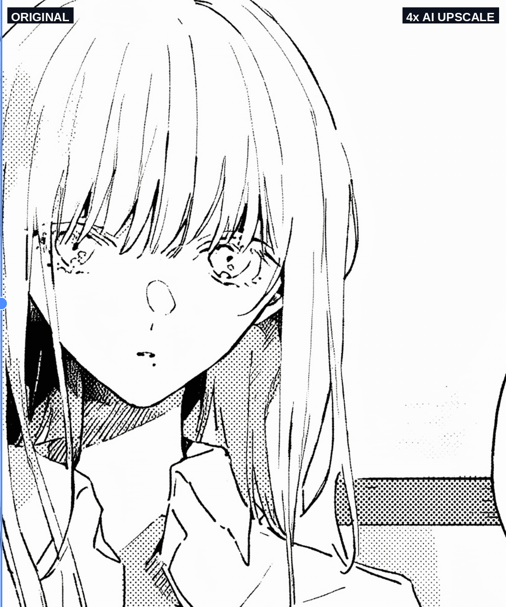

*The same crop before and after 4× enhancement. Results vary by source and model.*

### Anime library

Featured works, continue watching and your collection with status and genre filters.

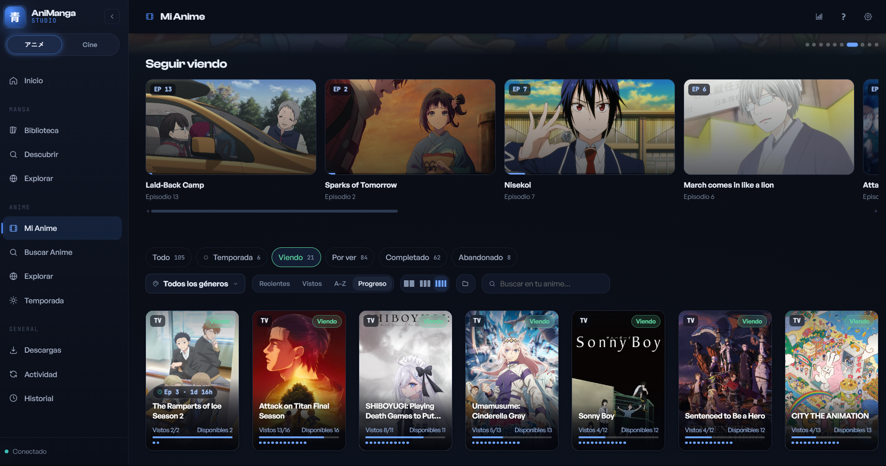

### Details and episodes

Episode thumbnails, viewing progress and playback/download actions, with watched state separate from file availability.

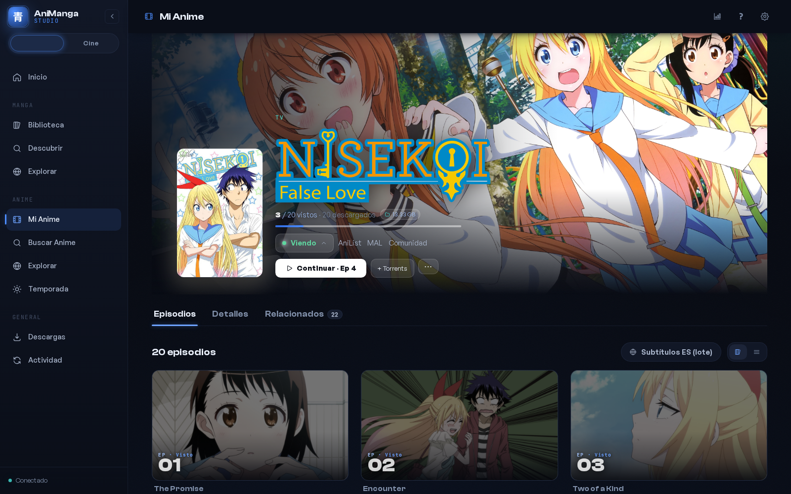

### Native PC player

Integrated libmpv playback with timeline, audio, subtitles, Anime4K and episode controls. The screenshot shows a double-restoration preset; the current maximum adds a third CNN restoration stage.

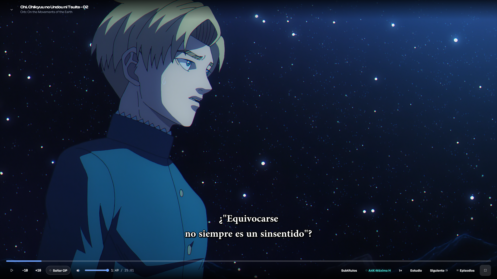

### Airing calendar

See releases by day and switch between weekly and agenda views. Times depend on catalog metadata.

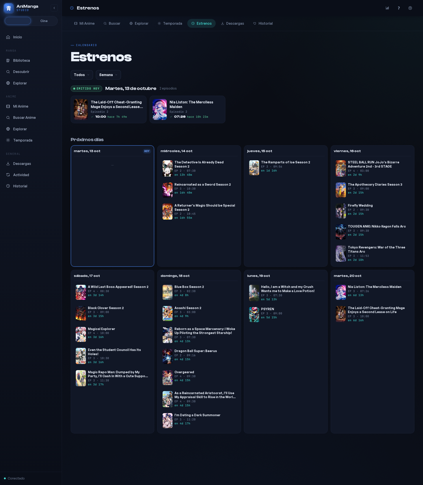

### Subtitle preparation

Embedded tracks and external subtitles are distinct inputs. Use an existing suitable track when available; translation and synchronization are separate operations, not mandatory steps for every episode.

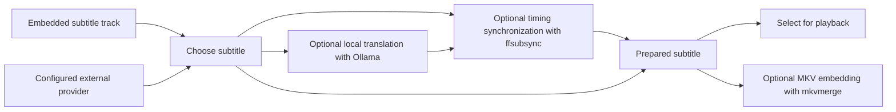

### Series and films

Cinema mode has its own library and navigation, without mixing titles into the anime collection.

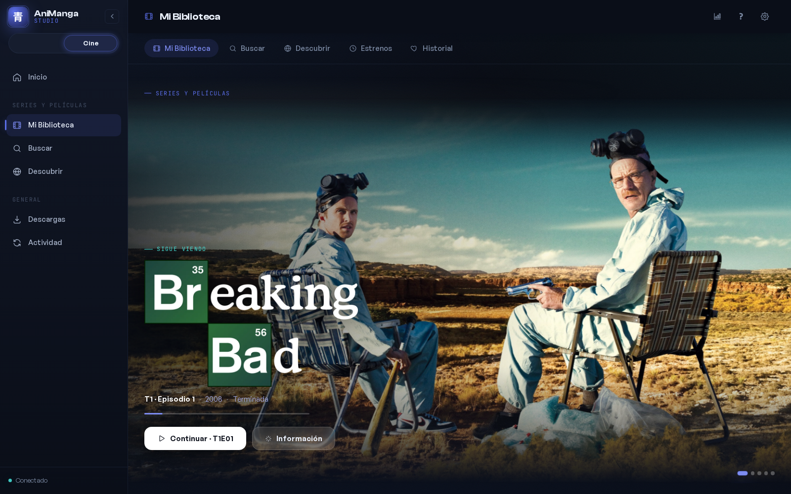

## Android

The companion is a separate Kotlin/Jetpack Compose project in the sibling folder `animanga-android`; its code and APK are not included here.

- Local manga library and downloads through MangaDex and compatible extensions.
- Offline manga reading without requiring an active PC for mobile-source titles.
- PC as an additional source, including downloading enhanced manga chapters.
- A separate CBZ/CBR archive library.
- PC anime playback/downloads and a seasonal calendar.

Heavy AI upscaling and translation remain on the PC; Android can consume their results.

## Getting started

The main desktop configuration is **Windows with a native Rust/WebView2 + libmpv shell and a backend in WSL2**. Other installation paths have different requirements and are not equivalent to this native playback configuration.

1. Follow [Desktop installation](docs/INSTALL_DESKTOP.md) for setup/build instructions.
2. Configure library paths and optional integrations using `.env.example`.
3. Install compatible weights for manga enhancement: [Model guide](docs/MODELS.md).
4. Configure qBittorrent's WebUI for torrents and Suwayomi for additional sources.

```bash
git clone https://github.com/RoierOc/animanga-studio.git
cd animanga-studio
```

[Backend installation](docs/INSTALL.md) covers dependencies, frontend compilation and system tools. After setup, `./start_server.sh` starts the backend at `http://localhost:5101` by default; it does not itself build the native Windows player.

**Hardware:** manga PyTorch upscaling requires a supported NVIDIA GPU and compatible CUDA/PyTorch installation. Anime4K uses the playback GPU through shaders, not the manga worker. Memory needs depend on model, page size and preset. Basic library management does not require AI inference.

**Optional tools:** Suwayomi/Java for additional sources; qBittorrent for torrents; FFmpeg/MKVToolNix for media operations; Ollama with downloaded language-model weights for subtitle translation; bsdtar for reading genuine CBR/RAR archives. Credentials are needed only for integrations that require them. Never commit your `.env`, personal library or secrets.

## Integrations

AniManga Studio integrates these projects and services without claiming their authorship or replacing their licenses:

| Project/service | Role |
|---|---|
| [Anime4K](https://github.com/bloc97/Anime4K) | CNN restoration, upscaling and line-refinement shaders |
| [mpv / libmpv](https://mpv.io/) | Native video and subtitle playback |
| [PyTorch](https://pytorch.org/) / [spandrel](https://github.com/chaiNNer-org/spandrel) | Local image inference and supported architecture loading |
| [Suwayomi Server](https://github.com/Suwayomi/Suwayomi-Server) | Optional manga-source server and extension integration |
| [MangaDex](https://mangadex.org/) / [AniList](https://anilist.co/) | Source access, discovery and metadata |
| [qBittorrent](https://www.qbittorrent.org/) / [Nyaa](https://nyaa.si/) | Torrent client integration and release discovery |
| [FFmpeg](https://ffmpeg.org/) / [MKVToolNix](https://mkvtoolnix.download/) | Media inspection and container/subtitle operations |
| [Ollama](https://ollama.com/) | Local subtitle-translation inference |

Suwayomi is an optional, separately obtained runtime, **not an included manga catalog**. Extensions access third-party services subject to their own terms and availability. Downloaded model weights, dictionaries and dependencies also keep their respective licenses.

## Content and licenses

AniManga Studio is a software tool, **not a distributor of anime episodes, manga chapters or subtitle collections**. Cloning the code does not include a personal media library. Imported/downloaded content is the user's responsibility: use material you own or are authorized to access, and respect copyright and service terms.

Interface screenshots and illustrative media in this documentation may show third-party artwork. They do not grant rights to the depicted works. The application license does not cover third-party artwork, media, extensions, model weights or dependencies.

The project's own code is [MIT licensed](LICENSE). Third-party components keep their own licenses and any obligations applicable to redistribution of packaged builds.
